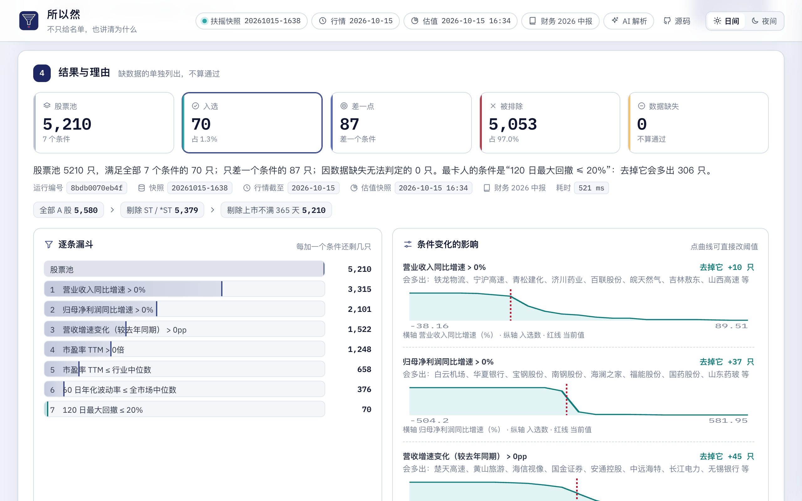
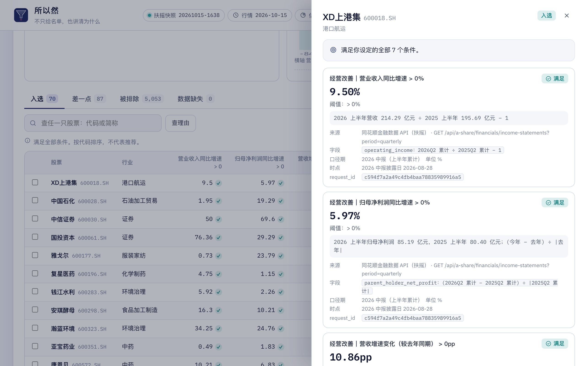
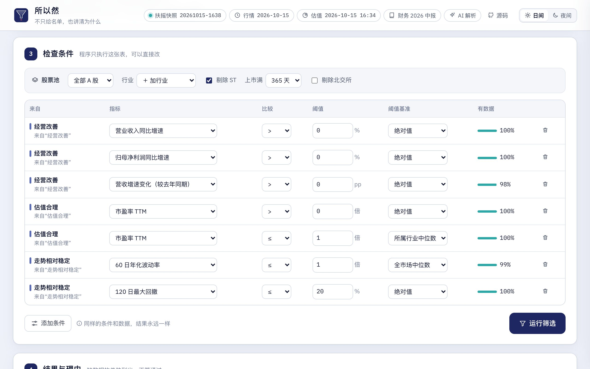
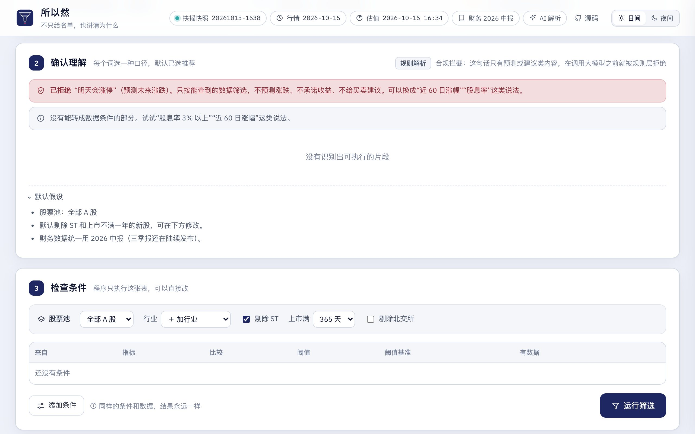
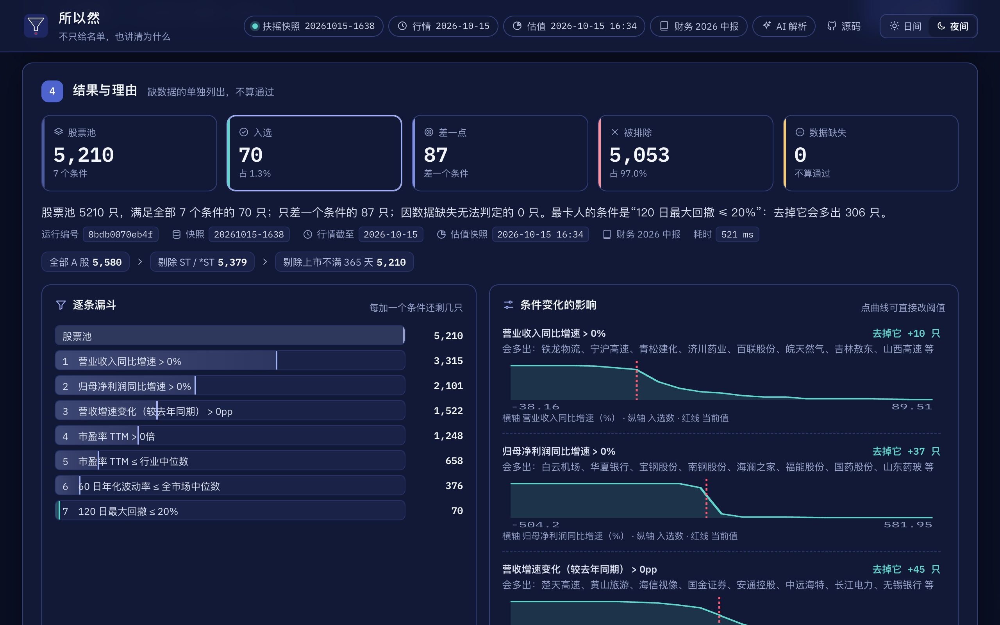
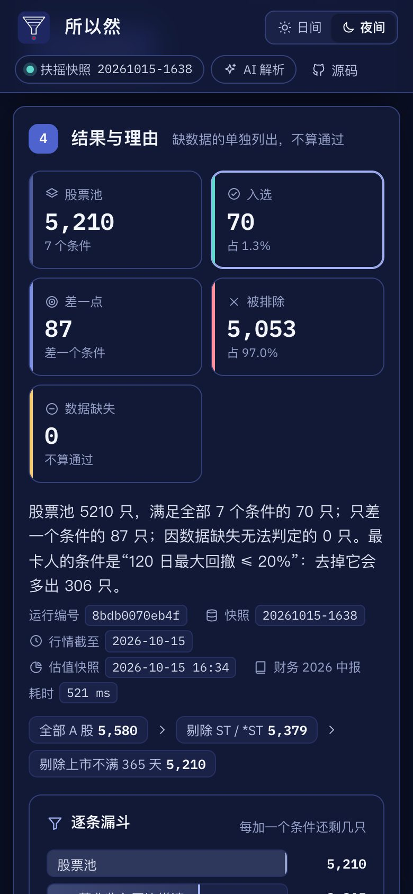
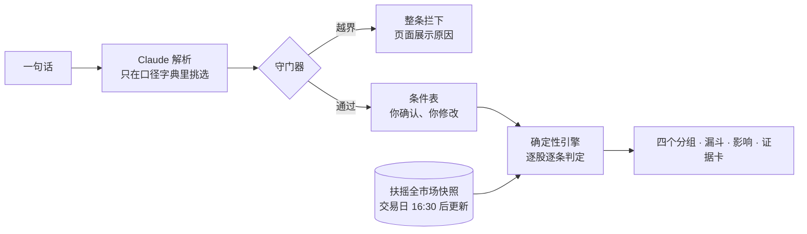

<div align="center">


# 所以然 · 一句话选股

**不只给名单，也讲清为什么。**

说一句模糊的选股想法，先确认每个词的意思，再用 A 股全市场真实数据逐条筛选。<br>
每只股票为什么入选、为什么被排除、条件变了会怎样，都摊开给你看。

[**在线体验**](https://mingshai-production.up.railway.app) &nbsp;·&nbsp; [**试一句：经营改善、估值合理、走势相对稳定**](https://mingshai-production.up.railway.app/?q=%E7%BB%8F%E8%90%A5%E6%94%B9%E5%96%84%E3%80%81%E4%BC%B0%E5%80%BC%E5%90%88%E7%90%86%E3%80%81%E8%B5%B0%E5%8A%BF%E7%9B%B8%E5%AF%B9%E7%A8%B3%E5%AE%9A&run=1) &nbsp;·&nbsp; [AI 使用与验证](docs/AI_USAGE.md) &nbsp;·&nbsp; [测试说明](docs/TESTING.md)


</div>

<p align="center"></p>

## 为什么做

“估值合理”是市盈率低于 30，还是不高于同行中位数？现有的一句话选股常常不告诉你它用了哪个口径；
结果只有一张名单，看不到每只股票卡在哪、差多少；缺数据的公司还会被悄悄当成“满足”。

所以然的做法：**理解交给大模型，判断交给可审计的程序，中间放一张你看得懂、改得动的条件表。**

0.2 版首先服务每周整理观察股票池、懂基本财务指标的个人投资者。目标是帮助用户建立、检查并保存自己理解的条件；实际节省时间与减少误解的效果仍需用户试用验证。见[产品选择与指标](docs/PRODUCT_DECISIONS.md)、[用户试用执行包](docs/USER_RESEARCH.md)。

### 本轮可靠性改进

- **保留完整意图**：支持行业排除；OR、复杂否定、不支持的期间与多年分红稳定性明确暂停执行，修改原句后重新解析。比较、证据、保存和监控也经过同一校验。
- **数据先验收再替换**：上市天数等关键字段覆盖率不合格时拒绝新快照；使用经过校验的旧快照并显示警告。少量股票的上市日期缺失会标为无法判定，不能当作上市不足一年。
- **解释绑定事实**：AI只选择事实编号；指标、数值、单位和期间由程序回填。模型不能通过交换已有数字改变含义。
- **实际状态可见**：AI区分待验证、成功、鉴权失败和降级；存在Key文件不代表调用成功。数据更新失败与回退时点会直接提示。

## 四步用起来

| ① 说一句话 | ② 确认理解 | ③ 检查条件 | ④ 结果与理由 |
|---|---|---|---|
| 口语、同义词、中英混写都行 | 每个模糊词给 2～3 种口径，默认推荐；做不到的口径也列出来并说明原因 | 程序只执行这张表；改阈值、换基准，实时提示冲突和缺数据 | 入选、差一点、被排除、数据缺失四组；点任一行看证据卡 |

<table>
<tr>
<td width="50%"><br><sub><b>确认理解</b>：每个词选一种口径，AI 的理解写在明处</sub></td>
<td width="50%"><br><sub><b>证据卡</b>：实际值、阈值、公式、接口、字段、报告期、request_id</sub></td>
</tr>
<tr>
<td width="50%"><br><sub><b>检查条件</b>：同样的条件和数据，结果永远一样</sub></td>
<td width="50%"><br><sub><b>合规边界</b>：不预测涨跌、不承诺收益、不给买卖建议</sub></td>
</tr>
</table>

<p align="center">
&nbsp;
<br>
<sub>日间 / 夜间一键切换，手机到宽屏都适配</sub>
</p>

## 能做什么

| 能力 | 说明 |
|---|---|
| **口径澄清** | 每个模糊概念 2～3 个可执行方案；“低于自身历史估值分位”这类做不到的口径单独列出并说明原因 |
| **条件可改** | 改指标、比较符、阈值、基准（绝对值 / 行业中位数 / 全市场中位数），增删条件；冲突、口径不适用、张力、缺数据比例实时提示 |
| **结果可解释** | 逐条漏斗；去掉每个条件会多出几只、多出谁；阈值曲线点一下就改阈值重跑；结果太少时给出最近的放宽点 |
| **证据可追溯** | 每个值都能追到扶摇接口、字段、报告期、数据时点和 request_id；事实、推断、不确定分三栏写 |
| **不静默** | 没有合格真实快照就不给结论；指标或股票池资格缺失单独说明；构建或质量校验失败不替换合格旧快照 |
| **后续动作** | 对比 2～5 只、保存策略、转为监控（每个交易日更新数据后自动重跑，记录新进入和移出的原因）、导出 CSV |
| **分享** | `/?q=一句话&run=1` 打开即自动解析并筛选 |

## 它怎么工作



| 契约 | 怎么兑现 |
|---|---|
| **AI 只翻译** | 输出受 JSON Schema 约束，逐片段过守门器；不允许输出股票代码、公司名或任何关于公司的数字 |
| **程序出结果** | 筛选、计数、敏感度全部是确定性计算；同一策略加同一快照得到同一个运行编号 |
| **数字有出处** | 证据卡里每个值都带来源接口、字段、报告期或窗口、单位、时点，以及扶摇返回的 request_id |

<details>
<summary><b>各角色的职责边界</b></summary>

| 角色 | 做什么 | 不做什么 | 失败时 |
|---|---|---|---|
| **大模型**（`llm.py` `parse_llm.py`） | 将原句映射到目录中的概念、指标、行业及行业排除；识别未支持和拒绝片段；为解读选择事实编号 | 不选股、不计算，不生成展示用的数值或公司结论 | 超时、鉴权失败或非法输出改用规则并提示；仍未完整识别时暂停执行；非法解释选择改用程序摘要 |
| **守门器**（`guard.py`） | 检查目录、数值、基准和未解决意图；字面比较符与行业排除另做一致性校验 | 不将未支持需求静默删除 | 原因明确展示，所有执行入口暂停该策略 |
| **确定性引擎**（`engine.py` `conflicts.py`） | 股票池过滤、逐股逐条三态判定、分组、漏斗、去掉条件的影响、阈值扫描、冲突与张力计数 | 不调用大模型、不联网 | 数据缺失 → “缺失”状态；可比公司不足 5 家 → 缺失 |
| **数据工具**（`data/fuyao.py` `data/build.py`） | 从扶摇取数，写台账，构建快照，原子替换 | 不做判断 | 限流退避重试；业务错误原样抛出；任一步失败不替换旧快照，状态写进 `build_state.json` 并在页面显示 |

</details>

## AI 用在哪，花多少

- **只做两件事**：把一句话翻译成条件草稿；选择最有用的已验证事实编号，由程序生成解读。
- **验证范围**：旧版33句结果保留为历史开发记录；旧评分把严格比较与含等号比较合并，不能代表真实任务正确率。当前改为精确比较符、数值、基准和多余条件校验，并另有意图边界与手算名单验收；见[评测说明](eval/README.md)。
- **成本**：一次解析约 0.012～0.034 美元（系统提示词走缓存）。线上设了**总额 5 美元的硬上限**：调用前按最坏情况预留，
  额度不够就永久切断并删除服务器上的 Key；另有限流（同一来源 10 分钟 15 次，全站每小时 40 次）。
- **兜底**：超时、鉴权失败、额度用完、限流时改用规则解析，页面写明实际状态；未完整识别的要求会暂停执行。恢复模型需有效凭据与一次成功调用，操作见[运行手册](docs/RUNBOOK.md)。

## 安全与隐私

- **仓库里没有任何密钥和个人信息**：Key 只放在部署平台的加密变量和服务器数据卷上权限 600 的文件里；测试会扫描仓库，发现密钥格式或本机路径就失败。
- **线上不收集个人信息**：没有账户体系，保存的策略只按浏览器里的匿名编号区分。
- **浏览器侧加固**：内容安全策略只允许本站脚本、禁止被别的网页嵌入；接口文档不对外公开；管理接口需要口令，按常量时间比对。
- **花费可控**：AI 总额度熔断加限流，见上一节。

## 数据与口径

全部来自**同花顺金融数据 API（扶摇）**，鉴权 `X-api-key`：

| 用途 | 接口 |
|---|---|
| 代码表、上市日期、ST 标记 | `GET /api/meta/tickers/list?asset_type=a-share` |
| 行业（同花顺行业指数，自动识别层级，取覆盖率 ≥ 80% 的最细一级） | `GET /api/a-share-index/catalog/ths-index-list?tag=industry` + `.../constituents/ths-stock-list` |
| 股票池与大中小盘代理（沪深 300 / 中证 500 / 中证 1000） | `GET /api/a-share-index/constituents/ths-stock-list` |
| 估值（PE TTM、PB MRQ、PS TTM、PCF TTM） | `GET /api/a-share/valuations/snapshot`（每次 100 只） |
| 财务比率：ROE、毛利率、净利率、负债率、流动比率、现金含量（2026 中报、2025 中报） | `GET /api/a-share/financials/indicators` |
| 营收、归母净利润原始金额与披露日（最近 9 个季度，用来自算增速） | `GET /api/a-share/financials/income-statements?period=quarterly` |
| 日 K（未复权）、近 10 日增量、除权除息事件 | `GET /api/dump/market-dumps/{daily-k, daily-k-10d, adjustment-factors}/download-url` |
| 交易日历（核对行情是否最新） | `GET /api/a-share/calendar/trading-days` |

<details>
<summary><b>口径决策与取数纪律</b></summary>

**口径决策**（都写在 `registry.py`，引擎、解释卡、守门器、前端共用这一份）：

- **增速用利润表自算**：扶摇财务指标接口的营收、净利润同比字段实测全为空（抽查 8 只、三个报告期），
  所以营收同比、归母净利润同比、二季度单季同比（累计值相减）都用利润表原始金额计算，证据卡展示金额和公式；
  利润同比的分母取上年同期绝对值（亏损收窄、扭亏记为正增长），分母为 0 或营收 ≤ 0 时记为缺失。
- **报告期统一用 2026 中报**：三季报正在披露，混用会让同一条件比较的不是同一段时间；证据卡提示“若三季报已在快照后披露，结论可能变化”。
- **ROE 年化**：原始字段是半年数据，展示为“原值 × 2”，证据卡同时给出原值。
- **行业中位数**：同花顺行业分组，只统计该指标有效（估值类只取正值）的非 ST 公司，可比公司不足 5 家记为缺失；参照池不随股票池变化。
- **大中小盘**：扶摇暂无市值字段，用沪深 300 / 中证 500 / 中证 1000 成分股代理，页面写明。
- **复权**：按除权除息事件自行推导参考价（扶摇约定的“原始数据为主”）；构建时体检除权日收益率，若 |r| > 25% 的占比超过 5%（单位理解错误的典型症状）就停止构建。
- **股息率**：近 365 天除息日的税前现金分红合计 ÷ 最新收盘价；尚未实施的预案不计入。

**取数纪律**：每次请求写入 `data/ledger.jsonl`（接口、参数、HTTP 状态、业务 code、request_id、条数、耗时，不含 Key）；
只对限流和上游暂时不可用做有限次退避重试；原始返回存 `data/work.duckdb` 支持断点续跑；快照先写临时文件，校验通过后原子替换。

</details>

## 本地运行

```bash
uv venv --python 3.12 && uv pip install -e ".[dev]"
cp .env.example .env                                   # 填扶摇 Key 文件路径；大模型可选
uv run --env-file .env python -m mingshai.data.build --limit 200 # 联调；全量去掉 --limit
uv run --env-file .env uvicorn mingshai.app:app --port 5577     # 打开 http://localhost:5577
```

没有任何 Key 也能体验流程：用 `MINGSHAI_DATA=demo` 启动，或访问 `/?data=demo`（合成数据，股票名带“演示”）。

**部署**：仓库带 `Dockerfile` 和 `railway.json`。Railway 上挂一个持久卷到 `/data`，在平台变量里配置 Key；
大模型 Key 首次启动时会搬进 `/data/llm.key`，之后从平台变量里删掉即可。服务启动后若没有快照会自动构建，
之后每个交易日北京时间 16:30 后日更一次，并自动重跑所有监控。

<details>
<summary><b>环境变量</b></summary>

| 变量 | 说明 |
|---|---|
| `FUYAO_API_KEY` / `FUYAO_API_KEY_FILE` | 扶摇 API Key（或只含 Key 的文件路径） |
| `MINGSHAI_LLM_PROVIDER` | `anthropic` / `openai_compat` / `off`；不填时按 Key 自动判断 |
| `MINGSHAI_LLM_API_KEY` / `MINGSHAI_LLM_API_KEY_FILE` | 大模型 Key |
| `MINGSHAI_LLM_MODEL` | 模型名；Claude 默认 `claude-opus-5-5` |
| `MINGSHAI_LLM_BASE_URL` | OpenAI 兼容接口地址（DeepSeek、通义等） |
| `MINGSHAI_LLM_EFFORT` | Claude 的 effort，默认 `low`（解析任务不需要深度推理） |
| `MINGSHAI_LLM_BUDGET_USD` | AI 调用总额上限，默认 `5`（美元，总额，不按月清零） |
| `MINGSHAI_LLM_SPENT_OFFSET_USD` | 账本之外已经花掉的金额（如开发期调用），计入总额 |
| `MINGSHAI_DATA` | `live`（默认）/ `demo` |
| `MINGSHAI_DATA_DIR` | 快照、台账、保存的策略所在目录 |
| `MINGSHAI_AUTO_BUILD` | `1` 时自动构建与日更 |
| `MINGSHAI_ADMIN_TOKEN` | 手动触发构建 `POST /api/admin/build` 的口令 |

</details>

## 测试

- `pytest`：主链路、数据契约、回退与修复、行业排除、意图拦截、事实绑定、额度和安全回归，见[测试说明](docs/TESTING.md)；最新结果以CI和实际输出为准。
- `eval/run_eval.py`：原33句开发集，现使用更严格的比较规则；模型结果必须重新运行，不能沿用旧版97%的数字。
- `eval/check_acceptance.py`：意图保真与安全边界回归，以及4只手工构造股票上的5组精确名单核对。该套件用于开发验收，不是盲测用户准确率。

## 已知边界与后续

- 估值接口只有最新快照：做不了“低于自身历史估值分位”，也不能对估值条件做无前视偏差的回测，所以**暂不提供历史回测**，
  宁可不做，也不给看似精确、实则有偏的收益曲线。后续可用财报披露日重建时点数据，先支持“行情加财务”类条件的回测。
- 没有市值字段，大中小盘用沪深 300、中证 500、中证 1000 成分股代理；三季报披露期内统一使用中报。
- 单季数据由累计值相减得到，个别公司更正过往报表时可能与原始单季披露略有出入。
- 监控只在页面记录变化，没有推送；后续可加 iFinD 交叉核验、市值与资金流等维度。
- 本版本不执行OR和嵌套逻辑；不支持的期间、历史排名、分红稳定性及未识别片段会阻止执行。行业排除已支持。
- 真实用户试用、完成时间与留存研究尚未开展，执行方案和空白记录表见`docs/USER_RESEARCH.md`。

## 文档

| 文档 | 内容 |
|---|---|
| [AI 使用与验证](docs/AI_USAGE.md) | 开发中用到的 AI、发现并修正的问题、评测、守门器、调用成本 |
| [测试说明](docs/TESTING.md) | 每个场景的预期和对应的自动化测试 |
| [产品选择与指标](docs/PRODUCT_DECISIONS.md) | 目标用户、取舍、待验证假设和完整任务指标 |
| [用户试用执行包](docs/USER_RESEARCH.md) | 任务卡、访谈提纲、记录表和复盘方法，尚未开展 |
| [运行手册](docs/RUNBOOK.md) | 数据契约、备份与修复、AI状态和上线验收 |
| [`scripts/demo_video/`](scripts/demo_video/) | 演示视频的制作脚本（本地配音、逐句字幕、成片验收） |
| [`scripts/readme_shots.py`](scripts/readme_shots.py) | 本页截图的生成脚本 |

---

<sub>**合规声明**：本项目只按用户设定的条件筛选并解释公开数据，不预测涨跌、不承诺收益、不构成任何买卖建议。历史数据和当期财务指标不代表未来表现。</sub>
