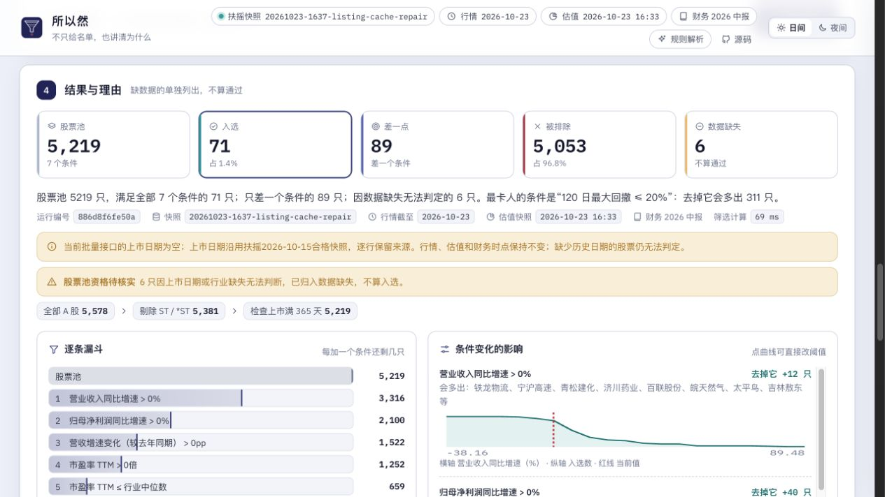
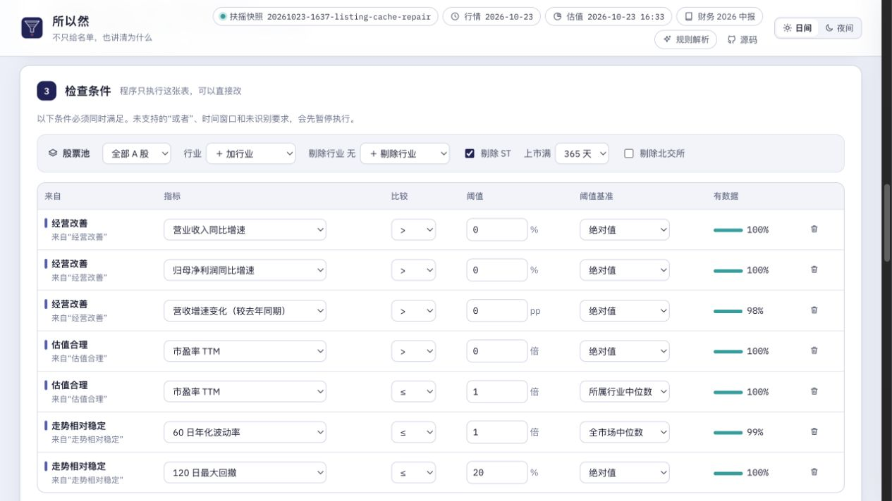
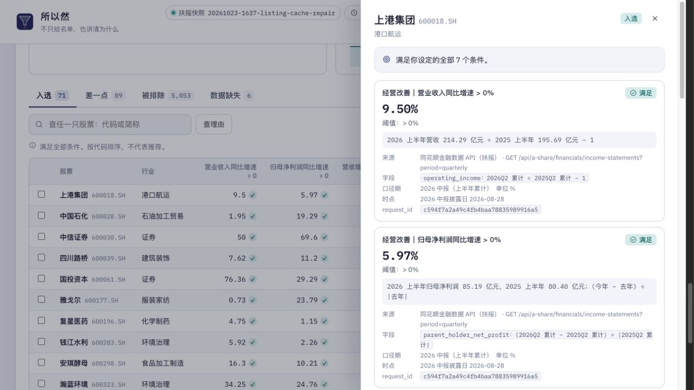

<div align="center">


# Natural-Language Stock Screener

**Turn an investment idea into editable criteria and inspect the evidence behind each result.**

[Live demo](https://mingshai-production.up.railway.app) · [How it works](#how-it-works) · [Run locally](#run-locally) · [简体中文](README.zh-CN.md)


</div>

Suo Yi Ran (所以然) helps users explore Chinese A-share stocks using a natural-language idea. It turns that idea into a reviewable condition table, applies the confirmed conditions with a deterministic engine, and shows why each stock passed, failed or could not be evaluated. The app and most supporting documentation are currently in Chinese. The project is an analytical tool, not a prediction or trading recommendation.

<p align="center"></p>

<sub>Screenshot from the deployed 0.2.1 application on October 25, 2026; see the [capture record](docs/images/v0.2.1/README.md). The screenshot uses rule-based parsing and displays data timestamps.</sub>

## How it works

1. **Describe an idea.** Natural language is mapped to supported concepts and metrics. An optional language model can draft criteria; rule-based parsing is used when the model is unavailable.
2. **Clarify and edit.** Review ambiguous terms, assumptions, thresholds and benchmarks. Unsupported or unresolved intent stops execution instead of being silently discarded.
3. **Screen deterministically.** The engine applies the conditions to a qualified snapshot. Missing data is reported separately, not treated as a pass.
4. **Inspect evidence.** Review the funnel, near misses, excluded stocks, condition sensitivity and evidence cards with fields, periods, timestamps and request IDs where available.

The model does not select stocks or calculate results. It may translate the request and select verified fact identifiers for explanations; displayed values and units are supplied by the program. The same strategy and snapshot produce the same run identifier.

<table><tr><td width="50%"></td><td width="50%"></td></tr></table>

## Features and boundaries

- Edit criteria, compare absolute values with industry or market medians, and review missing-data and conflict warnings.
- Explore the effect of removing conditions or adjusting thresholds; compare stocks, save strategies, monitor changes and export CSV.
- Use a synthetic demo without provider credentials. Live screening requires a qualified Tonghuashun Financial Data (Fuyao) snapshot and API access.
- Failed data builds or quality checks do not replace a previously qualified snapshot; fallback and data timestamps are shown.
- OR, nested logic, unsupported periods and some historical conditions are not executed. Unresolved intent must be corrected before screening.
- Historical valuation snapshots are unavailable in the current data pipeline, so the project does not offer historical backtests for valuation criteria. Large/mid/small-cap groups use CSI 300/500/1000 membership as proxies rather than market capitalization.
- The original 33-query development evaluation is not evidence of real-world accuracy; the current acceptance tests are not a blind user study. See [evaluation notes](eval/README.md).

## Run locally

Requires Python 3.11+ and [uv](https://docs.astral.sh/uv/). The following starts the synthetic demo without keys:

```bash
git clone https://github.com/flukier1016/nl-stock-screener.git
cd nl-stock-screener
uv venv --python 3.12
uv pip install -e ".[dev]"
MINGSHAI_DATA=demo uv run uvicorn mingshai.app:app --port 5577
```

Open `http://localhost:5577`. Demo stock names identify the data as synthetic. For live data, copy `.env.example` to `.env`, configure your Fuyao key securely, and build a snapshot before starting:

```bash
cp .env.example .env
uv run --env-file .env python -m mingshai.data.build --limit 200
uv run --env-file .env uvicorn mingshai.app:app --port 5577
```

The `--limit 200` build is for integration checks; omit the limit for a full snapshot. An LLM key is optional. See [`.env.example`](.env.example) and the [runbook](docs/RUNBOOK.md) for credentials, automatic updates, budget controls and recovery. Never commit keys or local snapshots.

## Data and methodology

The live pipeline uses Fuyao APIs for A-share metadata, industry and index membership, valuation snapshots, financial statements, prices, corporate actions and the trading calendar. It records source fields, reporting periods and request IDs for provenance. Snapshot construction validates key coverage and writes new data atomically only after checks pass.

Some definitions are deliberate proxies or approximations: growth rates are calculated from reported income-statement values, industry comparisons require sufficient valid peers, and dividend yield uses eligible cash dividends over the preceding 365 days divided by the latest close. Reporting-period and freshness limitations appear in the application. See the [Chinese data methodology](README.zh-CN.md#数据与口径) for the full definitions.

## Tests and documentation

```bash
uv run pytest
uv run python eval/check_acceptance.py
```

The suite covers the screening path, intent boundaries, data contracts, fallbacks and evidence binding; live model and provider tests require separate credentials. See [testing](docs/TESTING.md), [AI usage](docs/AI_USAGE.md), [evaluation](eval/README.md), [product decisions](docs/PRODUCT_DECISIONS.md) and [runbook](docs/RUNBOOK.md). These references are currently in Chinese.

## License and use

Project code is licensed under [MIT](LICENSE). Third-party data and provider content remain subject to their own rights and terms. The application filters and explains data based on user-defined criteria; it does not predict returns or offer buy/sell advice.
